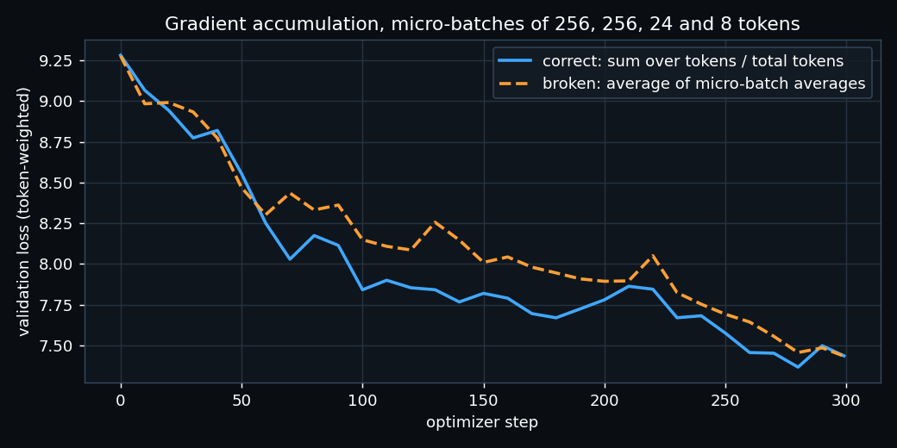
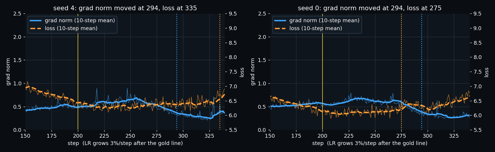

# ERA V5 · Session 10 — making the training loop tell the truth

Notebook: [`session10_training_loop.ipynb`](session10_training_loop.ipynb). It runs top to bottom on an Apple M5
(MPS). The model is in [`tinylm.py`](tinylm.py): 4-layer pre-norm transformer, d_model 192, tied head, 3.7M weights.
The data is my Session 2 tokenizer (10,000 tokens) and the English + Hindi corpus. All numbers are in
[`results.json`](results.json), and the per-step grad-norm logs are in [`gradnorm_log.json`](gradnorm_log.json).

To run it:

```bash
pip install torch tokenizers nbformat nbconvert matplotlib
python build_notebook.py
jupyter nbconvert --to notebook --execute --inplace session10_training_loop.ipynb
```

## 1. Every tensor shape in one step

The notebook prints 22 tensors, from the loader batch to the Adam moments, each with a one-line meaning.
The main path is:

```
batch (4, 33) → inputs (4, 32), targets (4, 32)
x = emb + pos (4, 32, 192) → qkv (4, 32, 576) → q (4, 6, 32, 32) → attention out (4, 6, 32, 32)
→ SwiGLU gate (4, 32, 512) → block out (4, 32, 192) → final norm (4, 32, 192) → logits (4, 32, 10001)
→ flat (128, 10001) and (128,) → loss ()
emb.weight.grad (10001, 192) · w1.grad (512, 192) · Adam exp_avg (512, 192) · exp_avg_sq (512, 192)
```

Every gradient and every Adam moment has the same shape as its weight. That is where "16 bytes per weight" comes from:
2 (bf16 weight) + 4 (fp32 master) + 4 (m) + 4 (v) + 2 (grad).

## 2. One gradient checked by hand

I nudge one weight by ε = 1e-6 both ways, take (L(w+ε) − L(w−ε)) / 2ε, and compare with `backward()`.
This runs in float64 on the CPU.

| weight | backward() | by hand | relative difference |
|---|---|---|---|
| `blocks[0].w1.weight[3,5]` | 1.1816499811e-04 | 1.1816592149e-04 | 7.8e-06 |
| `blocks[2].qkv.weight[100,17]` | 4.6942849784e-05 | 4.6942894016e-05 | 9.4e-07 |
| `emb.weight[144,9]` (tied with head) | 7.0858252280e-02 | 7.0858252599e-02 | 4.5e-09 |

They agree to at least 5 significant digits, and the notebook asserts it. The tied embedding is the interesting one:
its gradient is the sum of two paths, the input lookup and the output head, and autograd adds both correctly.

## 3. Gradient accumulation, broken on purpose

Each step has 4 micro-batches holding **256, 256, 24 and 8 real tokens**.

| | loss | gradient vs one big batch |
|---|---|---|
| one big batch (reference) | 9.29011 | — |
| correct: Σ token losses / total tokens | 9.29011 | relative error **1.2e-06** (identical) |
| broken: mean of the 4 micro-batch means | 9.26608 | relative error **1.69** (169% off) |

In the broken version the 8-token micro-batch gets **25%** of the vote. It should get 1.5% (8 of 544 tokens).

Then I trained both versions for 300 steps on identical micro-batches, and judged both by the same token-weighted validation loss:



From about step 60 the broken run falls behind. Between steps 100 and 290 it is on average **0.18 nats worse**
(step 100: 7.84 against 8.15). The two meet again at step 300, at 7.437 and 7.435.

The broken gradient is not random. It is the right gradient with the short sequences given far too much weight,
so the model still learns, only worse, and the curve still looks plausible. That is why this bug survived in every
framework until 2024.

## 4. The grad norm moving before the loss

**Setup.** I train normally for 200 steps (AdamW, β2 = 0.95, warmup to 2e-3). Then the learning rate grows
3% every step, the way a broken schedule would. Clipping is off, and the grad norm is logged at every step.

**The rule, the same for both traces.** Take the 10-step rolling mean, and measure its spread over a calm
baseline (steps 200–240). A trace has "moved" at the first step where it is more than 4 baseline standard deviations away.

I ran it with 5 seeds, because one run proves nothing either way:

| seed | grad norm moved | loss moved | which came first |
|---|---|---|---|
| 0 | step 294 | step 275 | loss, by 19 steps |
| 1 | step 290 | step 281 | loss, by 9 steps |
| 2 | step 286 | step 313 | **grad norm, by 27 steps** |
| 3 | step 284 | step 285 | grad norm, by 1 step |
| 4 | **step 294** | step 335 | **grad norm, by 41 steps** |



**The step I found: step 294 of seed 4.** The grad norm's 10-step mean had fallen to 0.369, against its baseline
of 0.553 ± 0.045, which is 4 standard deviations out. The loss there was still 6.365, inside its normal band
(6.324 ± 4 × 0.058). The loss only left its band 41 steps later.

**What surprised me.** The grad norm moved *down*, not up. As the learning rate climbs, AdamW takes bigger steps
and the weight matrices grow. Every layer feeds an RMSNorm, so the output does not care about the size of the
weights, and the gradient shrinks as 1 / ‖w‖. The falling grad norm was the weights inflating, long before the loss noticed.

**Honest summary.** In 3 of 5 seeds the grad norm moved first, and in 2 the loss moved first. On this small model the
grad norm is often the earlier signal, but not always. That is a reason to watch both traces, and to set alarms
for a grad norm that leaves its band in either direction.

## 5. My MFU

MFU = (6N + 12·L·T·d) × tokens/s ÷ machine peak, where N = 3.69M (non-embedding weights plus the head matmul).

Apple does not publish an fp32 TFLOPS number for the M5 GPU, so I **measured** the peak: the best large square
matmul on the same device, at the same time.

| run | tokens/s | achieved | peak (measured) | **MFU** |
|---|---|---|---|---|
| d=192, 4 layers, fp32 (my model) | 27,942 | 0.68 TFLOP/s | 2.16 fp32 | **31.7%** |
| d=512, 6 layers, fp32 (24M) | 6,705 | 1.03 TFLOP/s | 2.16 fp32 | **47.7%** |
| d=512, 6 layers, bf16 autocast | 9,979 | 1.53 TFLOP/s | 6.37 bf16 | **24.0%** |

My model is at **31.7%**. What I believe is costing the distance to 40%:

1. **The matrices are too small.** At d = 192 each matmul is tiny, so the GPU spends a large part of every step
   starting kernels and moving data, not multiplying. Making the same model wider (d = 512) lifts MFU to 47.7% with no other change.
2. **The work outside the matmuls.** RMSNorm, SiLU, the residual adds, the softmax over 10,001 tokens and the
   AdamW update all read and write memory and do almost no FLOPs. None of these are fused on MPS.
3. **The Python loop.** Every step goes through Python, the batch is built on the CPU and copied over, and the
   device is synchronised.
4. **bf16 is faster but its peak is higher still.** bf16 autocast gives 1.5× more tokens/s, but the bf16 matmul
   peak is 3× higher. So MFU drops to 24%: the non-matmul work (still fp32) now dominates.
5. **The machine itself.** This is a fanless MacBook Air, and the measured peak fell from 3.1 to 2.2 TFLOP/s over
   repeated runs as it heated up. MFU is always measured against the peak of the same moment.

## 6. The number 0.1, by hand

0.1 = 1.6 × 2⁻⁴. In binary, 1.6 = 1.1001 1001 1001 … (the pattern 1001 repeats forever). So the exponent is −4 in
every format, and the formats differ only in how many bits of the mantissa they keep.

**fp32** (1 sign + 8 exponent, bias 127, + 23 mantissa)
- exponent field = −4 + 127 = 123 = `01111011`
- the mantissa is the first 23 bits of .1001 1001 1001 1001 1001 100 |1 1… The next bit is 1, so it rounds up
  to `10011001100110011001101`
- bits: `0 01111011 10011001100110011001101` (0x3DCCCCCD)
- value **0.100000001490**, error +1.5e-9

**bf16** (1 + 8 exponent, bias 127, + 7 mantissa: the top half of fp32)
- the same exponent `01111011`
- the mantissa is the first 7 bits, .1001100 |1 1001…, and the rest is more than half, so it rounds up to `1001101`
- bits: `0 01111011 1001101` (0x3DCD)
- value = 1.6015625 × 2⁻⁴ = **0.10009765625**, error +9.8e-5 (0.1%)

**fp8 E4M3** (1 + 4 exponent, bias 7, + 3 mantissa)
- exponent field = −4 + 7 = 3 = `0011`
- the mantissa: 0.6 × 8 = 4.8, which rounds to 5 = `101`
- bits: `0 0011 101` (0x1D)
- value = 1.625 × 2⁻⁴ = **0.1015625**, error +1.6e-3 (1.6%)

The notebook reads the bits PyTorch actually stores for each format, and they match all three hand results.

**Which one I would train in.** I would use **bf16 for the matmuls, with fp32 master weights, fp32 Adam moments and fp32 accumulation.**

- bf16 has the same 8-bit exponent as fp32, so it covers the same range (about 1e-38 to 3e38). Small gradients
  do not underflow, and no loss scaling is needed (fp16 needs it).
- Its 0.1% rounding error is fine inside a matmul whose sum is accumulated in fp32.
- But it cannot hold the weights themselves. An update of 1e-4 on a weight of 1.0 is smaller than bf16's step
  size near 1.0 (2⁻⁷ ≈ 0.008), so the update would vanish. That is why the master copy stays fp32.
- **fp8 E4M3** has a 1.6% error on 0.1 and a range that tops out at 448. It works in production only with a scale
  per small block (DeepSeek-V3 uses 128-value blocks) and with fp32 accumulation, on hardware that has fp8 units.
  I would use it for large-scale matmuls on H100/B200, and never for the master weights, the optimizer state or the softmax.
