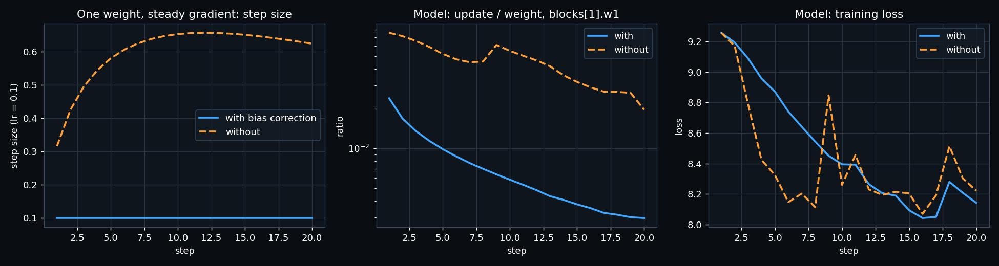
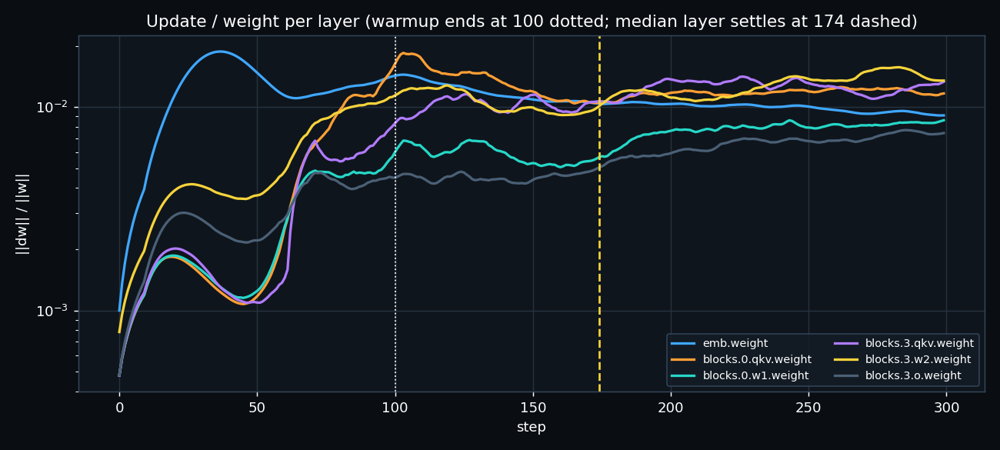
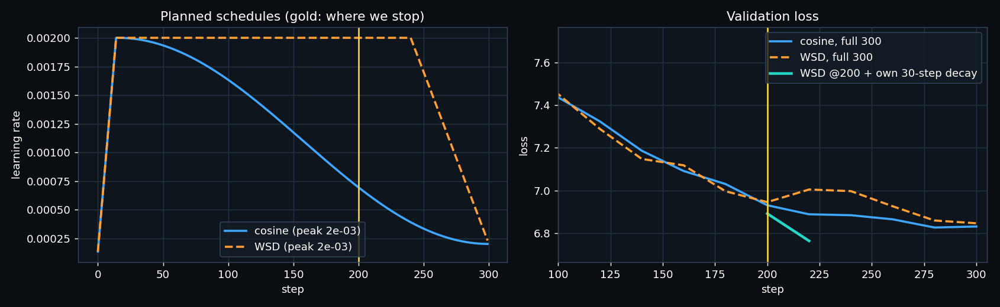
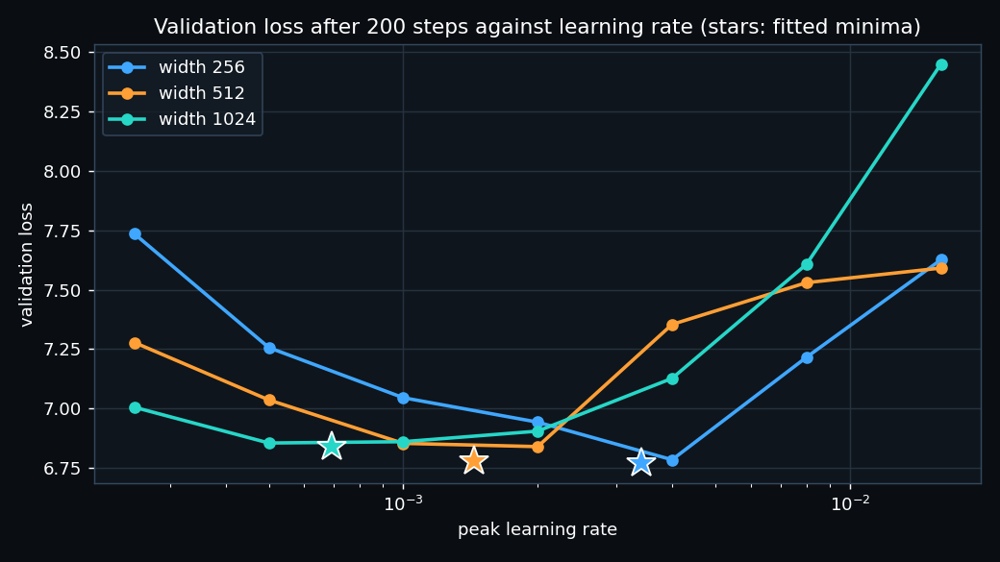

# ERA V5 · Session 11 — optimizers and learning-rate schedules, measured

Notebook: [`session11_optimizers.ipynb`](session11_optimizers.ipynb). It runs top to bottom on an Apple M5 (MPS).
The model is in [`tinylm.py`](tinylm.py), and the data is my Session 2 tokenizer with the English + Hindi corpus.

Raw numbers:
- [`results.json`](results.json): every result below
- [`update_ratio_log.json`](update_ratio_log.json): per-layer, per-step update ratios
- [`lr_sweep.json`](lr_sweep.json): all 21 sweep runs

To run it:

```bash
pip install torch tokenizers nbformat nbconvert matplotlib
python build_notebook.py
jupyter nbconvert --to notebook --execute --inplace session11_optimizers.ipynb
```

## 1. Adam by hand

One weight w₀ = 0.5 and five gradients (0.30, −0.10, 0.25, 0.40, −0.05).
Settings: η = 0.1, β₁ = 0.9, β₂ = 0.999, ε = 1e-8.

| t | g | m | v | m̂ | v̂ | step | w |
|---|---|---|---|---|---|---|---|
| 1 | 0.30 | 0.03000000 | 0.00009000 | 0.30000000 | 0.09000000 | 0.10000000 | 0.40000000 |
| 2 | −0.10 | 0.01700000 | 0.00009991 | 0.08947368 | 0.04997999 | 0.04002186 | 0.35997815 |
| 3 | 0.25 | 0.04030000 | 0.00016231 | 0.14870849 | 0.05415750 | 0.06390082 | 0.29607733 |
| 4 | 0.40 | 0.07627000 | 0.00032215 | 0.22177959 | 0.08065785 | 0.07809051 | 0.21798682 |
| 5 | −0.05 | 0.06364300 | 0.00032433 | 0.15541257 | 0.06499499 | 0.06096017 | 0.15702665 |

Every value matches `torch.optim.Adam` to **2.8e-17** (float64), and the notebook asserts it.

**Worked step 1:**
- m = 0.1 × 0.3 = 0.03, and v = 0.001 × 0.09 = 0.00009
- m̂ = 0.03 / 0.1 = 0.3, and v̂ = 0.00009 / 0.001 = 0.09
- step = 0.1 × 0.3 / √0.09 = 0.1 × 0.3 / 0.3 = **exactly η**

The first Adam step always has size η, whatever the gradient's size, because m̂ / √v̂ = g / |g| = ±1.

**Step 2 shows the averaging.** The gradient flipped sign, but m̂ is still positive (0.089), so the weight keeps
moving in the same direction, only more slowly (0.040).

## 2. Bias correction switched off

Without correction, the step is the corrected one times **(1 − β₁ᵗ) / √(1 − β₂ᵗ)**:

| step | corrected | uncorrected | ratio |
|---|---|---|---|
| 1 | 0.100 | 0.316 | 3.16× |
| 5 | 0.100 | 0.580 | 5.80× |
| 10 | 0.100 | 0.653 | 6.53× (the peak) |
| 20 | 0.100 | 0.624 | 6.24× |



Both moments start at 0, so both are too small at first. But √v is wrong by far more than m (√(1 − 0.999ᵗ) against
1 − 0.9ᵗ), so the *uncorrected* steps come out **too big**, not too small. That surprised me.

**When does the difference stop mattering?**

| β₂ | within 10% | within 1% |
|---|---|---|
| 0.999 (PyTorch default) | after **1,751 steps** | after **3,925 steps** |
| 0.95 (common in LLM training) | after 6 steps | after 9 steps |

So with the default β₂, bias correction matters for the first few thousand steps, which is the entire warmup of a real run.

**On the real model** (20 steps, lr 1e-3), the update/weight ratio of `blocks[1].w1` without correction was
0.0755, 0.0522 and 0.0197 at steps 1, 5 and 20. With correction it was 0.0241, 0.0099 and 0.0030.

The uncorrected run reached a slightly *lower* validation loss after 20 steps (8.606 against 8.687), simply because
it took bigger steps. But its updates were 7.5% of each weight per step, 75 times the healthy 1e-3. That is the kind
of start that diverges on a big model. Bias correction is, in effect, a built-in warmup for Adam.

## 3. The update-to-weight ratio of every layer through warmup

AdamW (β₂ = 0.999), peak lr 2e-3, 100 warmup steps. The table shows ‖Δw‖/‖w‖ for 21 weight matrices at
every step (selected layers here, all in the notebook):

| layer | step 1 | step 50 | step 100 | plateau | settles at |
|---|---|---|---|---|---|
| emb.weight | 1.0e-3 | 1.3e-2 | 1.4e-2 | 1.0e-2 | 124 |
| blocks.0.qkv | 4.8e-4 | 1.4e-3 | 1.8e-2 | 1.2e-2 | 134 |
| blocks.1.w1 | 4.8e-4 | 1.3e-3 | 6.2e-3 | 6.5e-3 | 177 |
| blocks.3.o | 4.8e-4 | 2.4e-3 | 4.2e-3 | 6.7e-3 | 174 |
| blocks.2.w2 | 7.8e-4 | 3.2e-3 | 1.1e-2 | 1.2e-2 | 70 |



**The step where warmup stops changing it: step 174.** That is the median over 21 layers (range 70–299). "Settled"
means the 10-step mean stays inside ±25% of its later plateau.

Warmup ends at step 100, but the ratios keep moving for another ~75 steps, for two reasons:
- Adam's v remembers ~1/(1 − β₂) = 1,000 steps, so the per-weight step size is still adjusting after the learning rate stops changing.
- The early gradients are correlated, which makes Adam's steps large. As they decorrelate, the ratio settles.

The output projections and `w2` settle earliest, and the last block's FFN settles last.

Our ratios sit near 1e-2, above the lesson's 1e-3 target, because this is a small model at a high learning rate
trained for a few hundred steps. Every layer's plateau is within a factor of 3 of every other layer's, which is
the healthy sign.

## 4. Cosine against WSD, stopped at step 200 of a 300-step plan

Both schedules have 15 warmup steps:
- **cosine** decays to 10% at step 300;
- **WSD** stays flat until step 240, then decays linearly over the last 20%.

**Both sides were tuned:** each got its own 3-point learning-rate sweep, and each is compared at its best.

| peak lr | cosine @ 200 | WSD @ 200 |
|---|---|---|
| 1e-3 | 7.139 | 6.950 |
| **2e-3** | **6.966** | **6.892** |
| 4e-3 | 7.149 | 7.177 |

**Both losses at step 200 (best lr for each): cosine 6.966, WSD 6.892.**



**Which model I would keep: the WSD one**, and not because it is 0.07 lower at step 200.

- At step 200 the WSD model has not decayed yet, so it is a *checkpoint I can still finish*. Given its own 30-step
  decay, it reaches **6.765** at step 230.
- The cosine model is stuck halfway down a curve that was planned for 300 steps. Continued 30 more steps on its own
  schedule, it is at 6.905.
- If the run had gone the full 300 steps, the two are equal (cosine 6.832, WSD 6.847).

So WSD matches cosine when you know the length, and wins when you don't. That is the lesson's point: cosine needs
the length of the run in advance, and WSD doesn't.

## 5. Learning-rate sweep at widths 256, 512 and 1,024

Setup:
- Standard parameterization: init std 0.02 at every width and one global AdamW lr.
- 2 layers, head dim 64, 200 steps, 20 warmup steps then cosine.
- Seven learning rates per width, with the same data order for all 21 runs.
- The marked minimum is the vertex of a parabola fitted through the best point and its two neighbours in log-lr.

| width | 2.5e-4 | 5e-4 | 1e-3 | 2e-3 | 4e-3 | 8e-3 | 1.6e-2 | **best lr** |
|---|---|---|---|---|---|---|---|---|
| 256 | 7.735 | 7.257 | 7.046 | 6.943 | **6.785** | 7.216 | 7.626 | **3.41e-3** |
| 512 | 7.278 | 7.037 | 6.854 | **6.840** | 7.354 | 7.530 | 7.591 | **1.44e-3** |
| 1024 | 7.006 | **6.856** | 6.861 | 6.906 | 7.127 | 7.607 | 8.449 | **6.90e-4** |



The best learning rate halves (slightly more) each time the width doubles. A least-squares fit gives
**lr\* ∝ width^−1.15**, close to the lesson's 1/width rule, with residuals under 5%.

**The value I would use at width 4,096: 1.4e-4.** The fit gives 1.37e-4, and the plain 1/width rule from 1,024 gives
1.73e-4. I'd start at 1.4e-4 and sweep 1e-4, 1.4e-4 and 2e-4 before the real run.

**How confident am I? Moderately, not more.**
- Three points fit a line very well, but 4,096 is 4× beyond the data.
- Each point is one seed of 200 steps at 2 layers. The real model is deeper and trains thousands of times longer,
  and the best lr usually drifts lower with longer training.
- The curves are flat near the minimum. At width 1,024, the losses at 5e-4 and 1e-3 differ by only 0.005, so the
  exact minimum could move by ~1.5× with another seed.
- This is exactly the problem μP solves: under μP, the 256-wide sweep would carry over directly, without the extrapolation.
