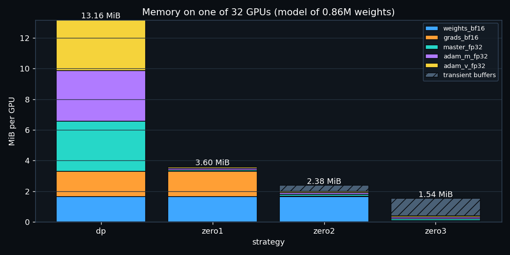
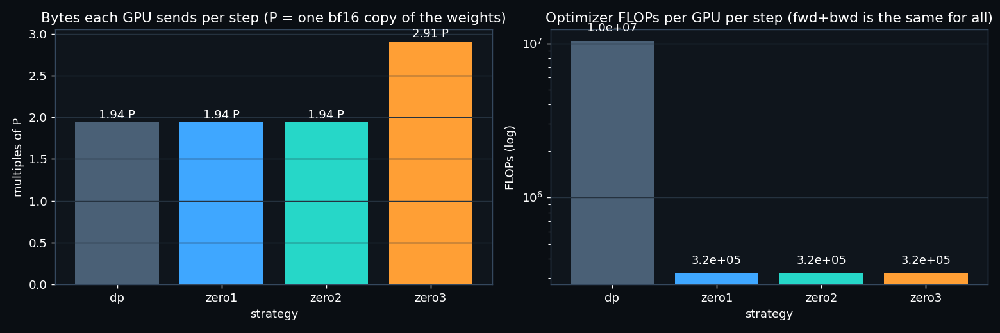
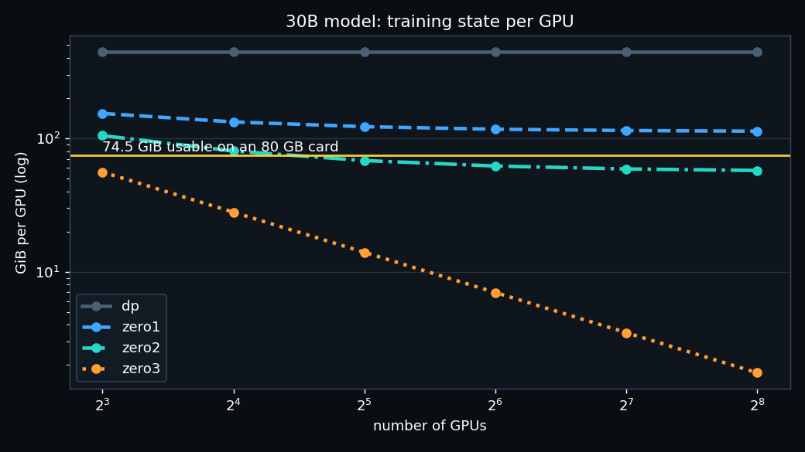

# ERA V5 · Session 12 — 32 virtual GPUs: data parallel, ZeRO-1, ZeRO-2, ZeRO-3

- Notebook: [`session12_zero.ipynb`](session12_zero.ipynb)
- Simulator: [`zero_sim.py`](zero_sim.py)
- Numbers: [`results.json`](results.json)

To run it:

```bash
pip install torch nbformat nbconvert matplotlib
python build_notebook.py
jupyter nbconvert --to notebook --execute --inplace session12_zero.ipynb
```

## What I built

32 virtual GPUs, each a `Rank` object with **its own storage**. A rank can only get another rank's data through
three collectives, which I wrote myself:

- **reduce-scatter**: everyone puts in a full tensor; rank *i* gets back only slice *i* of the sum.
- **all-gather**: everyone puts in a slice; everyone gets back the whole thing.
- **all-reduce**: = reduce-scatter + all-gather.

Each collective charges every rank the ring-algorithm cost: it sends (n − 1)/n of the buffer.

The model is a byte-level transformer: 4 layers, d = 128, 862,464 weights, trained on the Session 2 English + Hindi text.
Precision follows the lesson's 16-bytes-per-weight recipe:

| bf16 weights | bf16 gradients | fp32 master copy | fp32 Adam m | fp32 Adam v |
|---|---|---|---|---|
| 2 | 2 | 4 | 4 | 4 |

Each step uses a global batch of 32 micro-batches, one per GPU.

**The training is real, not drawn.** I trained the same model with five strategies (a single GPU, DP, ZeRO-1, ZeRO-2,
ZeRO-3) for 30 steps. **All four distributed versions ended with weights bit-identical to the single-GPU run**
(max difference 0.0, asserted in the notebook). The loss went from 5.79 to 2.42 in every one of them. That proves
the sharding changes only *where* things are stored and computed, not *what* is computed.

## The results (one GPU out of 32)

### Memory

| strategy | weights | grads | fp32 master + m + v | transient buffers | **peak** | **bytes per weight** |
|---|---|---|---|---|---|---|
| DP | 1,684 KB | 1,684 KB | 10,107 KB | 0 | **13,476 KB** | **16.00** |
| ZeRO-1 | 1,684 KB | 1,684 KB | 316 KB | 0 | **3,685 KB** | **4.38** |
| ZeRO-2 | 1,684 KB | 53 KB | 316 KB | 385 KB | **2,438 KB** | **2.44** |
| ZeRO-3 | 53 KB | 53 KB | 316 KB | 1,155 KB | **1,576 KB** | **0.50** |



### Communication and compute per GPU per step

| strategy | bytes sent | in units of P | forward + backward FLOPs | optimizer FLOPs |
|---|---|---|---|---|
| DP | 3.19 MiB | **1.94 P** | 6.62e8 | 1.04e7 |
| ZeRO-1 | 3.19 MiB | **1.94 P** | 6.62e8 | 3.23e5 (32× less) |
| ZeRO-2 | 3.19 MiB | **1.94 P** | 6.62e8 | 3.23e5 |
| ZeRO-3 | 4.78 MiB | **2.91 P** | 6.62e8 | 3.23e5 |

P is one bf16 copy of the weights. The ring cost turns 2P into 2P × 31/32 = 1.94P, and 3P into 2.91P.



The simulated wall times in the notebook are **not** a speed measurement. The 32 GPUs run one after another on one
CPU, and other jobs were running on the laptop at the same time.

## What I understood, in my own words

**Data parallel.** Every GPU has the whole model, the whole gradient and the whole optimizer state: 16 bytes per
weight, the same whether there are 2 GPUs or 1,000. Each GPU runs its own micro-batch, then an all-reduce makes
everyone's gradient the average. Then *every* GPU runs exactly the same Adam update on all P weights. That update is
32 copies of the same work on 32 copies of the same 12 bytes. That waste is what ZeRO removes.

**ZeRO-1: shard the optimizer state.** The fp32 master copy and the two Adam moments are 12 of the 16 bytes.
Each GPU keeps only its 1/32 slice of them. After backward, I replaced the all-reduce with its two halves:

1. A reduce-scatter gives each GPU the summed gradient for *its* slice only, which is all it needs to update that slice.
2. Each GPU updates its slice: its optimizer work drops 32×, from 1.04e7 to 3.23e5 FLOPs.
3. An all-gather of the new bf16 weights gives everyone the full model again.

Because an all-reduce *is* a reduce-scatter plus an all-gather, the communication is exactly what DP already paid
(1.94P both). ZeRO-1 saves 12 bytes per weight for free. At 32 GPUs: 2 + 2 + 12/32 = 4.38 bytes per weight.

**ZeRO-2: shard the gradients too.** After the reduce-scatter, a GPU only ever uses the gradient for its own slice,
so it can drop the rest. It keeps a gradient shard (2/32 bytes per weight) instead of a full gradient.

The catch is that backward produces the full gradient of a layer before it can be reduced. So there is a transient
buffer of one unit's gradient (385 KB here, the largest transformer block). The communication is still 1.94P.
Persistent memory is 2 + 14/32 = 2.44 bytes per weight.

**ZeRO-3: shard the weights as well.** Now nobody holds the full model between steps (rank 7 stores 26,952 weights, not 862,464).

- Before each unit's forward, its weights are all-gathered, used, then freed.
- Backward needs them again, so they are gathered a second time.
- That second gather is the extra cost: 3 × P instead of 2 × P (2.91P against 1.94P), **50% more communication**.
- In return, persistent memory is 16/32 = **0.5 bytes per weight**.

It also needs transient buffers: the gathered unit, a prefetch of the next unit (to hide the gather behind compute)
and a gradient bucket, 1,155 KB here. ZeRO-3's real peak is therefore set by **the size of the largest unit**,
not by the total model. That is why FSDP wraps the model per layer.

**Compute does not change.** Forward + backward is 6 × P × tokens on every GPU in every strategy (6.62e8 here).
ZeRO only removes the duplicated optimizer work and moves memory around. It is not a way to compute faster;
it is a way to fit.

## How the memory falls as GPUs are added

Measured in the simulator, in bytes per weight held by one GPU:

| GPUs | DP | ZeRO-1 | ZeRO-2 | ZeRO-3 |
|---|---|---|---|---|
| 1 | 16.00 | 16.00 | 16.00 | 16.00 |
| 8 | 16.00 | 5.50 | 3.75 | 2.00 |
| 32 | 16.00 | 4.38 | 2.44 | 0.50 |

ZeRO-1 never goes below 4 (the replicated weights and gradients). ZeRO-2 never goes below 2 (the replicated weights).
Only ZeRO-3 keeps falling as 16/n.

The same formula at the lesson's **30B model**, with 74.5 GiB usable per card:

| GPUs | DP | ZeRO-1 | ZeRO-2 | ZeRO-3 |
|---|---|---|---|---|
| 8 | 447.0 GiB | 153.7 GiB | 104.8 GiB | **55.9 GiB** ✔ fits |
| 32 | 447.0 GiB | 122.2 GiB | **68.1 GiB** ✔ fits | 14.0 GiB |
| 256 | 447.0 GiB | 113.1 GiB | 57.4 GiB | 1.7 GiB |



These match the lesson's table (153.7 / 104.8 / 55.9 GiB at 8 GPUs). DP and ZeRO-1 never fit, at any GPU count:
the 4 bytes per weight of replicated weights and gradients is already 111.8 GiB at 30B. So for V5 the real choice is
ZeRO-2 on 32+ GPUs (no extra communication) or ZeRO-3 on 8 (50% more communication, much more room for activations).
Picking between them needs a measured step time on the real cluster.
