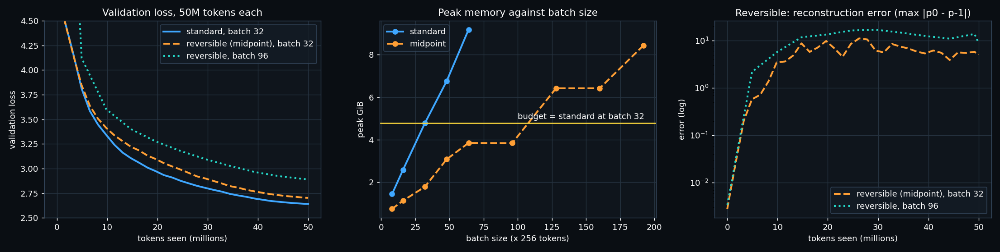

# ERA V5 · Session 13 — a 20M LLM for 50M tokens, standard against reversible

- Notebook: [`session13_reversible.ipynb`](session13_reversible.ipynb). It runs the gradient check live, shows the memory
  probe and loads the full-run logs.
- Training code: [`rev_train.py`](rev_train.py). Commands:
  - `python rev_train.py prep` once
  - then `./run_all.sh`
  - speed benchmark: [`bench.py`](bench.py)
- Logs of every run (every step, validation every 200 steps): [`logs/`](logs/)

**Hardware:** Apple M5 MacBook Air (24 GB unified memory, MPS), bf16 autocast. No Colab.

**Data:** WikiText-103. 175M characters were tokenized with my Session 2 tokenizer, giving 64M training tokens, so 50M tokens
is less than one epoch: no repetition.

**Model:** 19.87M parameters.
- 9 pre-norm transformer blocks, d = 384, 6 heads, SwiGLU, context 256, tied embedding.
- All three runs use exactly the same blocks and the same parameter count. Only the way they are stacked changes.

## The three runs

| run | rule | batch | steps | tokens | **final val loss** | final train loss | **peak memory** | **speed** (idle machine) |
|---|---|---|---|---|---|---|---|---|
| 1. standard | p ← p + f(p), activations stored | 32 | 6,103 | 49,995,776 | **2.656** | 2.636 | **4.53 GiB** | **12,425 tok/s** |
| 2. reversible | midpoint, batch fixed | 32 | 6,103 | 49,995,776 | **2.716** | 2.683 | **1.32 GiB** | 9,125 tok/s |
| 3. reversible, max batch | midpoint | **96** | 2,034 | 49,987,584 | **2.905** | 2.874 | **3.74 GiB** | 7,376 tok/s |

**About the speeds.** The tokens/s figures come from [`bench.py`](bench.py), run afterwards on an idle machine: 15 warm-up
steps, then 40 timed steps per configuration. The wall-clock times of the training runs themselves are **not** comparable:
- the standard run shared the GPU with two other experiments;
- the laptop went to sleep for several days during the reversible run.

The logs keep the raw numbers anyway.

## Which reversible variant worked

I implemented two and ran a 400-step pilot of each, with the same seed and data (`logs/pilot.json`):

| variant | rule | val after 400 steps | speed in the pilot |
|---|---|---|---|
| standard | p ← p + f(p) | 4.169 | 8,282 tok/s |
| **midpoint** (Gal et al. 2025, the lesson's rule) | p[l+1] = p[l−1] + 2h·f(p[l]), h = 0.5 | **4.145** | 5,438 tok/s |
| RevNet coupling | x₁ += Attn(x₂); x₂ += MLP(x₁) | 4.161 | 4,425 tok/s |

**Midpoint worked best, so the full runs use it.**

Its reversible backward is **correct**. In fp32 it gives the same gradients as ordinary autograd through the same rule:
relative error **1.6e-6**, and the input is rebuilt to **5e-7**. The notebook re-runs this check.

The backward pass walks down the stack and rebuilds each state with p[l−1] = p[l+1] − 2h·f(p[l]). Only the last two states
are ever stored.

## Findings

**1. Memory: reversible stores far less, and fits 3× the batch in the same budget.**

The budget is what the standard model needs at batch 32 (4.78 GiB, measured).

| batch | standard peak | midpoint peak |
|---|---|---|
| 32 | 4.78 GiB | 1.78 GiB |
| 64 | 9.18 GiB (over) | 3.85 GiB |
| 96 | — | **3.84 GiB** (fits) |
| 128 | — | 6.42 GiB (over) |

So the standard model's maximum is batch 32, and the reversible model's is **batch 96, 3× larger**. During the
real runs the peaks were 4.53 GiB (standard) against **1.32 GiB** (reversible), the same model storing **3.4× less**.

The lesson quotes a 9.9× batch gain for a much deeper model. Mine is smaller because:
- this model has only 9 layers, so there are fewer stored activations to remove;
- the weights, Adam state and the 10,000 × 256 logits do not shrink at all;
- the MPS allocator grows in large steps: 64 and 96 have the same peak, and 128 and 160 have the same peak.

**2. Speed: reversible costs about a third more compute per token.**
- At the same batch: 12,425 → 9,125 tok/s, **27% slower**. That is inside the lesson's 30–50% estimate, because each block runs its forward pass a second time during backward.
- Batch 96 was slower again per token on this Mac (7,376 tok/s). On a GPU with spare compute a bigger batch is usually faster; here the M5 is already saturated at batch 32, so the bigger batch buys nothing in speed.
- **Reversibility pays when memory is the limit, and costs you when it isn't**, exactly as the lesson says about the Lightning LM 2B model.

**3. Quality: midpoint reversible trains, but slightly worse, and the reconstruction drifts in bf16.**
- At the same batch, the final validation loss is 2.716 against 2.656 (+0.06).
- The third panel shows why. The rebuilt input should equal the true input exactly. In bf16 the error starts at 3e-3 and
  grows to **5–15** as training goes on and the weights grow.
- Each rebuild subtracts 2h·f(p) computed in bf16. bf16 rounding (about 0.4%) does not cancel, and the midpoint rule
  is only *marginally stable*: errors carry forward through the layers instead of dying out. The lesson warns about this.
- The gradients are therefore computed on slightly wrong activations. The model still learns, but a little less per token.
- **What I would do for V5:** run the reconstruction in fp32 (or keep fp32 copies of the boundary states and add the f
  outputs in fp32), and log the reconstruction error as a dashboard signal.

**4. Pushing the batch to the maximum did not help at a fixed 50M tokens.**
- Batch 96 took 3× fewer optimizer steps (2,034 against 6,103) and ended at 2.905, the worst of the three.
- With a fixed token budget, a larger batch means fewer updates. I scaled the learning rate by √3, but that did not make up for it.
- The memory reversibility frees is worth spending on **longer sequences or a bigger model**, not on a bigger batch for a small model.

**5. Everything else I checked:**
- The gradient-norm curves of all three runs are smooth: no spikes.
- No NaNs.
- The training and validation losses track each other: no overfitting, because 50M tokens is under one epoch.
