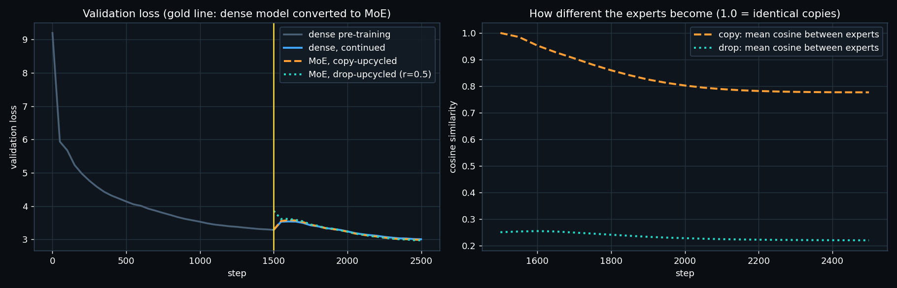

# ERA V5 · Session 14 — train a dense model, convert it into an MoE, keep training

[`upcycle.py`](upcycle.py) does the whole experiment in one run (`python upcycle.py`, about 45 minutes on an Apple M5).
The training logs are in [`logs/`](logs/):
- [`train.log`](logs/train.log): the human-readable log, every 50 steps
- [`dense_pretrain.jsonl`](logs/dense_pretrain.jsonl), [`dense.jsonl`](logs/dense.jsonl), [`copy.jsonl`](logs/copy.jsonl),
  [`drop.jsonl`](logs/drop.jsonl): every step's loss, grad norm and learning rate, plus validation loss and MoE health every 50 steps
- [`results.json`](results.json): the final numbers

**Data:** the 6,636 Opus 4.7 reasoning traces I cleaned in Session 4, tokenized with my Session 2 tokenizer: 10.3M tokens,
with the last 5% held out for validation.

## The setup

1. **Dense pre-training:** a 4-layer transformer (d = 256, SwiGLU FFN 768 wide, 6.0M parameters), 1,500 steps × 32 × 128 tokens.
2. **Conversion**, at step 1,500. Every layer's FFN is replaced by a mixture of **8 experts, top-2 routing**, made from the dense FFN:
   - **copy (sparse upcycling):** every expert is an exact copy of the dense FFN. The router is new, with tiny weights.
   - **drop (drop-upcycling, r = 0.5):** every expert is a copy with **half of its neurons re-drawn** at random.
   - Balancing is **auxiliary-loss-free**, as in DeepSeek-V3. A per-expert bias is added to the router scores *only to choose*
     experts, and it is nudged after every step towards an even load.
3. **Continue training**, 1,000 more steps for each branch. The control (dense, continued) gets the same data order, the same
   warmup (50 steps) and the same schedule.

## Results

| branch | total params | active params | val loss at conversion | val loss after 1,000 steps | change |
|---|---|---|---|---|---|
| dense, continued (control) | 6.00M | 6.00M | 3.2889 | **3.0070** | −0.282 |
| MoE, copy-upcycled | 22.53M | 8.37M | **3.2889** (identical) | **2.9896** | −0.299 |
| MoE, drop-upcycled | 22.53M | 8.37M | 3.9190 | **2.9749** | −0.944 |

**Both MoE models keep training and keep reducing the loss, and both end below the dense model.**

### What the numbers show

**1. Copy-upcycling preserves the function exactly.** The validation loss right after conversion is 3.2889, identical to
the dense model's to four decimals. With identical experts and top-2 gates that sum to 1, the MoE output is
`g₁·FFN(x) + g₂·FFN(x) = FFN(x)`. The conversion loses nothing.

**2. The bump after conversion is the learning-rate re-warm, not the MoE.** All three branches jump at step 1,550,
including the *dense control*. They re-warm to the peak learning rate on an already-trained model (Session 15's
"unfreeze or merge → re-warm the LR"). The bump is the same size for the dense and MoE branches, so it does not change the comparison.

**3. The hard part is making the copies different.** In the copy branch, the mean cosine similarity between experts
starts at **1.000**. It falls to 0.985 after 50 steps, 0.80 after 500, and **0.777** at the end. The experts do separate,
but slowly, because they start identical and get almost the same gradients. Drop-upcycling starts them at **0.25**,
already different, and they stay diverse (0.22).

**4. Drop-upcycling pays a price at the start and wins at the end.** Re-drawing half of the neurons costs 0.63 nats
immediately (3.29 → 3.92). After 1,000 steps it is the best of the three (2.975). That is the lesson's result in
miniature: drop-upcycling with r = 0.5 trades a worse start for better expert specialisation.

**5. Load balance (MaxVio = busiest expert's load ÷ mean − 1, per layer, at the end):**

| branch | layer 0 | layer 1 | layer 2 | layer 3 | dead experts |
|---|---|---|---|---|---|
| copy | 0.58 | 1.97 | 2.14 | 2.52 | 0 |
| drop | 0.44 | 1.51 | 0.87 | 1.29 | 0 |

There are no dead experts in either branch. Copy-upcycled routers are more unbalanced in the deeper layers: when experts are
near-identical, the router has no reason to spread tokens, and the bias-based balancer has to work against that.
The bias update (1e-3 per step) is slow for a 1,000-step run. A real run would use a larger step during the first
few hundred steps after conversion.

### What this does *not* show (honest limits)

- **Not compute-matched.** Top-2 of 8 experts makes each token's FFN twice as large (8.37M active against 6.00M). Part of
  the MoE gain could come from that extra compute, not from routing. The fair next test is a dense model with a 2× wider
  FFN trained the same 1,000 steps, or top-1 routing.
- **One seed, 1,000 steps, small data.** The gaps (0.017 and 0.032 nats) are small. The direction matches the published
  results (sparse upcycling beats continued dense training; drop-upcycling beats plain copying), but this run alone is
  not proof of it.
