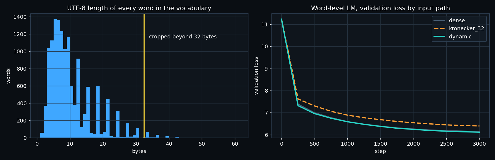

# ERA V5 · Session 7 — Problem 3: a Kronecker embedding with no 32-byte window

**The problem I picked: number 3.** Today's Kronecker code gives every token a fixed 256 × 32 grid, one column per byte
position. That causes two separate problems:

1. **Waste.** "a" and "apple" each own 32 position slots. In my vocabulary the average word is 9.7 bytes, so
   **70% of every grid is empty**, and the projection still multiplies all of it.
2. **Cropping.** Bytes after position 31 are thrown away. Words that agree on their first 32 bytes become **the same
   vector, forever**. This hits Indian languages hardest: a Devanagari letter is 3 bytes, so 11 letters already fill the window.
   The lesson's own example is `अंतर्राष्ट्रीयकरण` (51 bytes) against `अंतर्राष्ट्रीयता` (48 bytes).

Code: [`dyn_kron.py`](dyn_kron.py) (`python dyn_kron.py`). Numbers: [`results.json`](results.json). Logs: [`logs/`](logs/).

## My solution: Dynamic Kronecker

Keep the Kronecker idea (byte value ⊗ position), but replace the 32 one-hot position columns with a **continuous position
code** φ(p) of P = 32 numbers (sines and cosines at geometric frequencies, like the Transformer's positions):

```
Kronecker (lesson):  code(w) = 1/√L · Σ_{p<32}  onehot(byte_p) ⊗ onehot(p)     # bytes after 31 are dropped
Dynamic (mine):      code(w) = 1/√L · Σ_{p<L}   onehot(byte_p) ⊗ φ(p)          # every byte, any length
```

- **No length limit, no crop.** φ(p) is defined at every position, so a 60-byte word is encoded completely.
- **No wasted slots, and no 8,192-dim vector at all.** The projection is stored as `W` of shape (256, P, d). Each step builds
  a small table T[b, p] = φ(p) · W[b] (256 × max_len × d). Each word then sums only **its own L rows**, so a 3-byte word costs
  3 rows and a 60-byte word costs 60. The cost follows the word, not a fixed window.
- **The same parameter count** as Kronecker at pos_dim = 32: 256 × 32 × d. And P is now a capacity knob, not a length
  limit. You can raise P for more capacity without changing the longest word you can encode.
- **Still deterministic and vocabulary-free**: no V in the parameter count, exactly like Kronecker.

## The proof, in three experiments

### 1. Collisions on real text

Vocabulary: every distinct word in my Session 2 corpus (English + Hindi Wikipedia), 13,728 words, of which 3,233 are Devanagari.

| | Kronecker-32 | Dynamic |
|---|---|---|
| words that share their code with another word | **17** (7 groups; 12 Devanagari, 5 Latin) | **0** |
| the lesson's pair `अंतर्राष्ट्रीयकरण` / `अंतर्राष्ट्रीयता`, distance between codes | **0.0** (identical) | **1.40** |
| smallest distance between two different words (3,000-word sample) | **0.0** | 1.00 |
| words longer than 32 bytes (all cropped by Kronecker) | 154 (133 Devanagari) | none cropped |

Real collisions from the data:
- `अर्थव्यवस्था` / `अर्थव्यवस्थओं` ("economy" and a variant form)
- `राज्यक्षेत्र` / `राज्यक्षेत्रों` ("territory" / "territories")

Each pair differs only *after* byte 32. A Hindi singular and its plural become the same token to the model.

### 2. Can the word be recovered from its embedding? (a probe)

The task: a linear layer d = 128 → word id, trained to read the word back out of its input embedding. It is the simplest
test of whether the embedding still knows which word it is. 4,000 steps.

| input path | input params | accuracy, all words | accuracy, words > 32 bytes |
|---|---|---|---|
| dense table | 1.76M | 100% | 100% |
| Kronecker-32 | 1.05M | 99.93% (**= its ceiling**: one word per collision group can be right) | **93.5%** |
| **Dynamic** | 1.05M | **100%** | **100%** |

Kronecker is not under-trained: it sits exactly at the ceiling its collisions allow. Dynamic has no ceiling.

### 3. A language model with each input path

**Setup.** Word-level LM, 4 layers, d = 192, context 64, 3,000 steps. The only change between runs is the input path.

**Data.** 9.6M words of WikiText-103, with a vocabulary of 62,468 words. It has **no word longer than 32 bytes**, so cropping
cannot matter here. This tests whether making the code dynamic *costs* anything when there is nothing to crop.

| input path | input params | total params | final train loss | **final val loss** |
|---|---|---|---|---|
| dense table | 11.99M | 25.78M | 5.82 | 6.146 |
| Kronecker-32 | 1.57M | 15.36M | 6.20 | 6.401 |
| **Dynamic** | **1.57M** | **15.36M** | 5.83 | **6.119** |



**Dynamic matches the dense table (slightly better, 6.119 against 6.146) with 7.6× fewer input parameters, and beats
Kronecker-32 by 0.28 nats at the same size.** That was more than I expected, and I believe the reason is sharing:

- With one-hot positions, the row for (byte b, position 17) is learned only from words that have that byte at exactly
  position 17. Rare (byte, position) pairs get few updates.
- With φ(p), every position shares the same P = 32 features, and neighbouring positions get similar codes. So what is
  learned about byte b at position 5 also helps at positions 4 and 6.

One honest caveat on that 0.28: the lesson's Kronecker also z-normalises the code. I implemented both paths the same way
(the 1/√L scale and the same initialisation), but without z-normalisation. A tuned Kronecker baseline might close part of the gap.

## What I'd do next

- **Measure per script on the real V5 vocabulary.** The fix matters most where words are long in bytes: Devanagari, Tamil,
  Telugu and Malayalam, and agglutinative words.
- **Make φ partly learned** (a small MLP on top of the sinusoids), to see whether the position features themselves benefit from training.
- **Try P = 16 and P = 64.** Because P no longer limits length, it can be tuned purely for quality per parameter.
