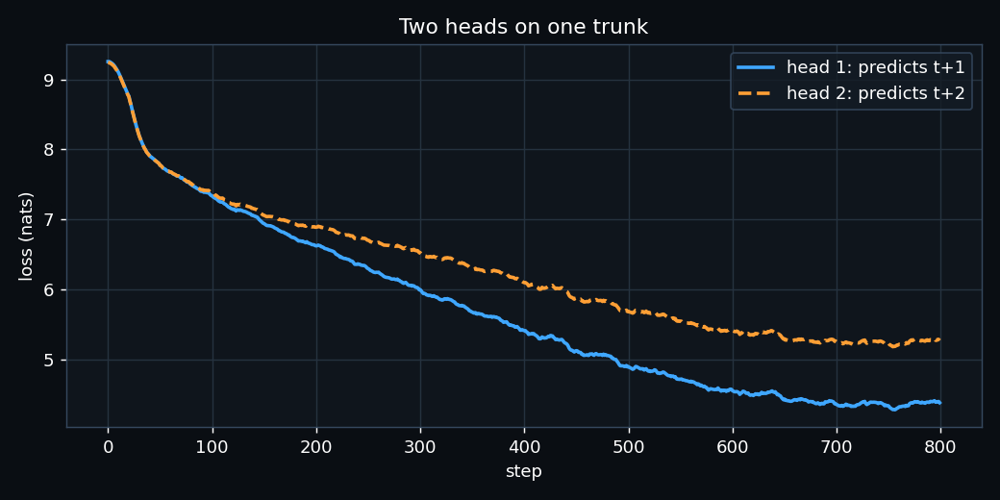

# ERA V5 · Session 9 — a loss harness that tells the truth

Notebook: [`session9_loss_harness.ipynb`](session9_loss_harness.ipynb). It runs top to bottom, and every
number below is printed by it. The raw numbers are also in [`results.json`](results.json), and the per-step log of the
two-head run is in [`two_heads_log.json`](two_heads_log.json).

- **Model:** a 4-layer pre-norm transformer (d_model 192, 6 heads, RMSNorm, SwiGLU, context 256).
- **Tokenizer:** my Session 2 BPE tokenizer (`../session-2/tokenizer.json`, 10,000 tokens, plus one PAD id, so V = 10,001).
- **Data:** the Session 2 English and Hindi Wikipedia text, 300 documents and 169,532 tokens.
- **Device:** Apple M5 (MPS).

To regenerate the notebook and run it:

```bash
pip install torch tokenizers nbformat nbconvert matplotlib
python build_notebook.py
jupyter nbconvert --to notebook --execute --inplace session9_loss_harness.ipynb
```

## Part 1: the seven numbers

| # | Check | Result |
|---|---|---|
| 1 | Every tensor shape | `tokens (4,16)` → `hidden (4,16,192)` → `logits (4,16,10001)` → `logits[:, :-1] (4,15,10001)` and `tokens[:, 1:] (4,15)` → flat `(60,10001)` and `(60,)` → `loss ()` |
| 2 | Shift verified with strings | The input `'▁Republic'` has the target `'▁of'`, and the input `'▁of'` has the target `'▁India'`. The notebook also asserts that every target is the token one step to the right. |
| 3 | Padding mask | Contributing targets fall from **124 → 86** (38 padding targets dropped). |
| 4 | Packing two documents | Mean loss **6.779** (naive) → **6.713** (boundary masked). The boundary target alone costs **13.74** nats. |
| 5 | Perplexity, untrained | **10,510** against V = 10,001 (ln V = 9.210, loss 9.260). After 300 steps it is 978. |
| 6 | Tied against untied head | Untied **5,660,736** and tied **3,740,544** parameters. Tying saves 1,920,192 (33.9%). |
| 7 | Peak memory of cross-entropy | Ordinary **937.6 MB**, chunked **91.9 MB**. The ratio is **10.2×** (N = 8,192 positions). |

### What each one means

**1. Shapes.** The two slices do different jobs. `logits[:, :-1]` drops the last position, because nothing follows it.
`tokens[:, 1:]` drops the first token, because nothing predicts it. Both end with length T − 1, so position *t* lines up
with token *t + 1*.

**2. The shift.** The notebook prints strings, not ids. A wrong shift (target = input) would teach the model to copy, and
the loss curve would still look beautiful. The check `tgt != inp` catches that.

**3. Padding.** PAD is its own id (10,000). Targets that are PAD become `-100`, and `cross_entropy(ignore_index=-100)`
leaves them out of both the sum and the count. The mean then divides by 86 real targets, not 124.

**4. Packing.** Document A (40 tokens) and document B (40 tokens) share one row. At the seam, A's last token is asked
to predict B's first token. Nothing in A can know how an unrelated document starts, so that target scores 13.74 nats,
twice the average, and can only teach noise. The fix has three parts:

- mask that one target with `-100`,
- use a block-diagonal causal attention mask, so B cannot read A,
- restart the position ids at 0 for B.

The mean falls from 6.779 to 6.713. Most of the drop is the one boundary target leaving the average. B's own loss
moves slightly (7.159 → 7.207): with the naive mask, B was leaning on A's unrelated context. With the correct mask it
has only its own tokens.

**5. Perplexity.** A model that knows nothing spreads probability evenly: p = 1/V, loss = ln V, perplexity = V.
The fresh model gives 10,510, within 5% of 10,001, so the init and the loss are sane. The notebook asserts this
(within 15%) before it goes further.

**6. Tying.** The head is a V × d matrix, 10,001 × 192. In this small model that is a third of all parameters,
because the vocabulary is large compared with the width. In a big model (d = 4,096+) the same matrix is a much smaller share.

**7. Memory.** Ordinary cross-entropy builds the full `(N, V)` logits: 312 MB in fp32. Autograd keeps it for backward,
and backward makes another tensor of the same size for its gradient, so the peak is about 3 × 312 MB = 938 MB.

My `ChunkedLinearCE` works through 512 rows at a time. For each chunk it computes the logits, the loss and
**the gradient at once**, using `softmax − onehot`, then frees that chunk. Only the hidden-state gradient (N × d)
and the weight gradient (V × d) are kept. The loss and both gradients match ordinary cross-entropy to 1e-8
(this is asserted). Peak memory is 91.9 MB, 10.2× less.

How it is measured: a background thread samples `torch.mps.current_allocated_memory()` every 0.1 ms during forward and
backward. I take the largest of 3 runs and subtract the baseline.

## Part 2: a second head predicting t + 2

Both heads share one trunk. Head 1 predicts `tokens[t+1]` and head 2 predicts `tokens[t+2]`.
The training loss is `loss₁ + loss₂`, trained for 800 steps.

| | head 1 (t+1) | head 2 (t+2) |
|---|---|---|
| first 20 steps (train) | 8.789 | 8.780 |
| last 50 steps (train) | **4.373** | **5.261** |
| drop | 4.416 | 3.519 |
| validation | **6.499** | **7.184** |
| validation sum | | **13.683** |



**What I see.** Both heads start at the same place, about ln V, because neither knows anything. Up to step ~100 they
fall together, since both are learning the same easy things: common tokens and simple bigrams. After that they split. The t+2 head falls more
slowly and levels off about 0.9 nats higher, and the gap does not close.

The reason is that the t+2 head must guess token t+2 *without having seen token t+1*. It has to average over every
token that could come next before it picks the one after. Some of that uncertainty can never be removed, however
long we train. That is why the gap stays open.

The t+2 head still learns a lot: its loss drops by 3.5 nats. Its gradient flows into the shared trunk and pushes the
hidden state to carry information about what comes further ahead. That is the idea behind multi-token prediction
(DeepSeek-V3's MTP), where the extra head is a training signal, not something used at inference.

**Honest note.** The corpus is small (170K tokens), so after 800 steps the model is overfitting: train is 4.37 and
validation 6.50. Both heads overfit by a similar amount, so the comparison between them still holds.
